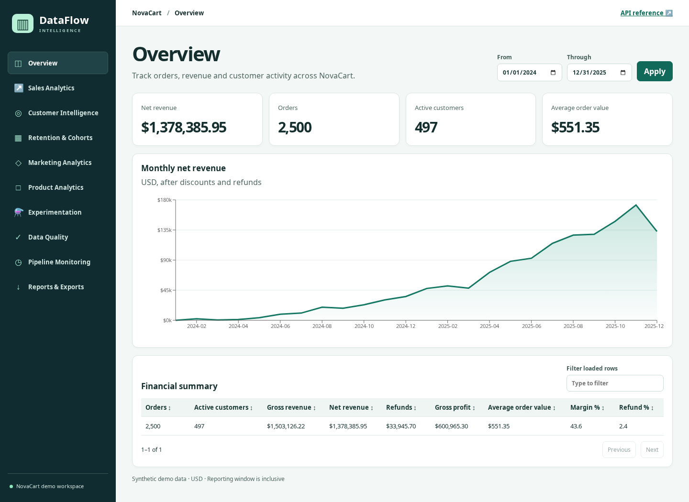

# DataFlow Intelligence BI Edition

Analyze revenue, customer retention, products and checkout experiments using the same synthetic NovaCart dataset across PostgreSQL, a React dashboard and an exportable business intelligence model.



## Run on Windows

Open Docker Desktop, extract this ZIP, and run from the extracted DataFlow-Intelligence-BI folder.

```powershell
docker compose up --build -d --wait
docker compose exec -T app python scripts/smoke.py
powershell -ExecutionPolicy Bypass -File .\bi-export.ps1
```

Open the [dashboard](http://localhost:8000) or [API reference](http://localhost:8000/docs). On Linux/macOS, run `sh bi-export.sh` for the final step. Docker is the only prerequisite for the web app and snapshot exporter. The default snapshot includes 2,500 orders, $1,378,385.95 net revenue, 497 active customers, and 6,000 checkout sessions. A prebuilt copy is in bi-sample.

If the earlier DataFlow release is already running, stop it with `docker compose down` from its original folder before starting this build. This edition has a separate Compose project name and volume. Both use host port 8000.

## Use the BI materials

| Goal | Start here |
|---|---|
| Build a Power BI Desktop model and report | [M queries, DAX, relationships and five report layouts](bi/powerbi/README.md) |
| Build a refreshable Excel workbook | [Excel for Windows generator with Power Query, PivotTable, slicer, XLOOKUP and chart](bi/excel/README.md) |
| Validate Excel exports immediately | [Original generated Excel report](reports/NovaCart_Business_Analysis.xlsx) |
| Use Google Sheets | [QUERY, ARRAYFORMULA and KPI exercise](bi/sheets/README.md) |
| Practice cross-platform SQL | [SQL Server, Snowflake and BigQuery import exercises](bi/sql/README.md) |
| Compare statistical tests | [SAS and SPSS checkout exercise](bi/statistics/README.md) |
| Practice additional business tools | [Tableau, GA4, Salesforce, Power Apps and Power Automate exercises](bi/platforms/README.md) |
| Present a business review | [PowerPoint business review](bi/case-study/NovaCart-Business-Review.pptx), [case study](bi-sample/BusinessReview.md) and [requirements and UAT](bi/case-study/Acceptance.md) |
| Review evidence before updating a resume | [Skills and verification matrix](bi/SkillEvidence.md) |

Desktop and hosted tools require the corresponding host or account. This ZIP contains the M and DAX source and a report build guide for Power BI. Excel automation is supplied as a PowerShell script. The verification report distinguishes tests performed locally from platform exercises.

## Verify without desktop BI software

With Python 3.12 and the project dependencies installed:

```sh
python -m pip install -r requirements.txt
python -m app.bi check bi-sample
python -m scripts.bi_exercises bi-sample
```

The BI exporter reads a single PostgreSQL snapshot, then independently loads the exported facts and dimensions into SQLite. It verifies primary keys, foreign keys, order and line totals, checkout integrity and snapshot checksums. The SQL labs compare revenue, region, products, cohorts and checkout against known outputs. Use `python -m scripts.bi_exercises bi-output --write` to produce a case study and refreshed expected results from a new export. Run `python -m scripts.bi_exercises bi-sample --postgres` with DATABASE_URL configured for the cross-engine checks.

The [original project guide](ORIGINAL-README.md) covers native development, the dbt model, authentication for refreshing synthetic data, and the existing analytics pages. See [verification](BI-VERIFICATION.md) for the BI edition's test results.
