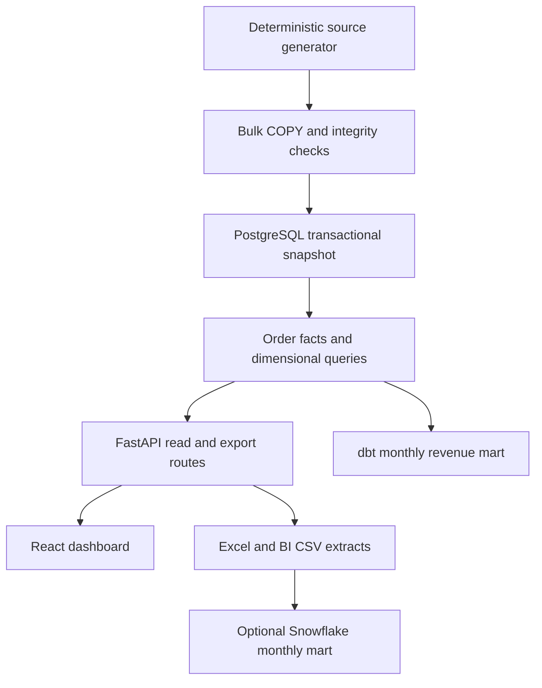

# DataFlow architecture

The generator creates independent customer/product/marketing sources, orders with multiple lines, order-level refunds, and independent checkout sessions. The refresh takes a PostgreSQL session advisory lock, records a run, loads records via COPY and publishes them in one transaction. Readers see the prior committed data until the refresh commits. SQL integrity checks abort the transaction on a bad snapshot. A failed run records its outcome in a separate transaction.

The order fact has one row per order. Items have one row per order/product. Customers, products and campaigns are reusable analytical dimensions. Session facts have one row per synthetic visit. SQL calculates metrics on the committed snapshot. dbt constructs the monthly view using the order fact as a source.

## Definitions

| Measure | Definition |
|---|---|
| Gross revenue | Quantity times item list price |
| Sales | Gross revenue less line discounts |
| Net revenue | Sales less order-linked refunds |
| Gross profit | Net revenue less cost of goods sold |
| Gross margin | Gross profit divided by net revenue |
| Refund rate | Refunded cents divided by sales cents |
| Average order value | Net revenue divided by order count |
| Active customers | Distinct customers with an order in the window |
| Repeat customers | Customers with at least two orders in the window |
| Observed customer value | Net sales per customer in the window, used for RFM |
| RFM | Recency at window end, order count, and observed net value. At risk if inactive for over 90 days. Champions have at least 5 orders and $1,000 net value. |
| Cohort retention | Customers from a first-purchase month who bought in the activity month, divided by the original cohort size |
| Conversion | Sessions that converted divided by all sessions |
| Cart abandonment | Cart sessions without conversion divided by cart sessions |
| ROAS | Campaign-attributed net revenue divided by campaign lifetime spend |
| MoM and YoY | Change versus prior month or same month last year within the selected series |
| Experiment effect | Treatment conversion minus control conversion, in percentage points |

Dates are inclusive. Refunds use order date attribution, even when the refund settles later. Product totals use line sales before refunds because refunds exist at order grain. Campaign spend and impressions describe lifetime synthetic campaigns. Date filters constrain attributed sales. Divide by zero produces null. Cohort history is based on all orders through the selected end date. The first and last reported months may be partial.

The checkout experiment uses an independent-session two-sided pooled proportion z-test, an approximate 95% Wald interval and a sample size estimate for equal-sized arms. Synthetic assignments are scoped to sessions. Repeated customer exposure and sequential monitoring would require a different real-world analysis plan. Revenue workbook statistics describe selected months and apply pandas numeric coercion plus NumPy finite filtering.
